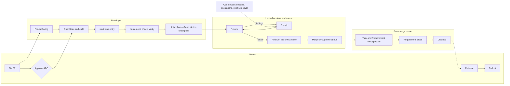

# Task lifecycle map

This document maps how one unit of work moves from a Business Requirement to merge, release and rollout. For each stage it names the actor, the entry and where the stage's state lives. It also records the approved **target** lifecycle that the simplification Requirements deliver, so it holds the current map and the destination side by side. The rationale is [DEC-0008](../decisions/0008-target-task-lifecycle.md). The detailed rules of each stage stay in their canonical documents ([task intake](task-intake.md), [agent workflow](agent-workflow.md), [OpenSpec workflow](openspec-workflow.md), [hosted lifecycle workers](hosted-lifecycle-workers.md), [chat coordinator](chat-coordinator.md), [release policy](../release-policy.md)); [OpenSpec](../../openspec/specs/) defines accepted executable behavior. Where this map and a spec differ, the spec governs until the corresponding simplification change lands.

## Actors

| Actor | What it is | Decides or does |
| --- | --- | --- |
| Owner | the human | product meaning, ADD approval, risk acceptance, release and rollout |
| Coordinator | the chat coordinator session | stream allocation, starting repair, owner escalations; writes no task code |
| Developer | an agent in the task worktree | pre-authoring, OpenSpec authoring, implementation, checks, handoff |
| Hosted worker | `lifecycle-workers.yml` on GitHub Actions (every 10 minutes and after the queue) | review, finalize, integration-merge (`DEV_PLATFORM_HOSTED_KINDS`) |
| Queue | `publication-queue.yml` with the GitHub App | merge into `main` |
| Post-merge runner | the LaunchAgent on the operator machine, every 10 minutes | retrospective, terminal reconciliation, cleanup |

## Current lifecycle

| # | Stage | Entry | Actor | Produces |
| --- | --- | --- | --- | --- |
| 1 | Fixation | `requirement_intake.py create` | developer at the owner's request | `type:requirement` Issue, Backlog card |
| 2 | Pre-authoring | `requirement_intake.py start`, then `orchestrate_pre_authoring.py` and `add_intents.py` | developer; owner approves the ADD | snapshot, ADD, intents, handoffs under `.claude/pre-authoring/` |
| 3 | Child creation | `requirement_intake.py materialize-handoff` / `link-child` | developer | `type:internal-change` Issue with an R2/R3 start tier |
| 4 | Start | six entries: `execute_requirement.py advance`, `start_managed_task.py`, `execute_managed_task.py`, `dogfood_task.py start --change`, `start_task.py`, `start_worktree.py` (plus `agent_board.py start`) | developer | worktree, board claim, `.managed-task-state.json` |
| 5 | Routing | `dogfood_task.py route-claude --tier R1/R2/R3` | developer | routing receipt |
| 6 | Implementation and checks | `select_checks.py --execute --evidence`, then `verification.md` | developer | content-bound evidence |
| 7 | Handoff | `dogfood_task.py finish` → `finish_developer_handoff` → `publication_queue.py admit`; friction checkpoint | developer | exact-head PR, v2 record, `lifecycle:review-pending`; claim released |
| 8 | Review | `lifecycle_workers.py work-next --kinds review` | hosted worker | disposition or `repair-pending` |
| 9 | Repair | `work-next --kinds repair` | local, started by the coordinator | repair commit, re-review |
| 10 | Finalize | `work-next --kinds finalize` | hosted worker | archive and re-run checks → `ready` |
| 11 | Merge | queue and `integration-merge` | queue, hosted worker | `lifecycle:merged` |
| 12 | Post-merge | `post_merge_runner.py` → retrospective → terminal reconciliation → cleanup | runner | `post-merge:settled`, Requirement Done, worktree removed |
| 13 | Composition (two or more children) | `requirement_integration.py` and `requirement_composition.py`, driven by `advance` | developer, local review | shared `requirement/BR-N` PR through the queue |
| 14 | Release | release PR changing `VERSION` → `publish-version.yml` | owner | immutable tag |
| 15 | Rollout | manual **Roll Out Platform** dispatch | owner | downstream PRs |

A quick task runs `start_task.py` → `finish` → queue → post-merge and skips stages 1–3 and 5. A downstream `light` profile has no queue or workers: `finish` archives and publishes itself.

## Where the current lifecycle is tangled

- **Archive** happens in three places: the developer (`AGENTS.md`, `execute_requirement.py`, `task-intake.md`), the finalize job ([agent workflow](agent-workflow.md)) and composition finalization. Archive also starts a second review. Missing archive prerequisites surface one at a time.
- **Start** has six entries plus board registration, each leaving different local state.
- **Requirement retrospective** has three moments and three actors: the agent before publication, the post-merge job, and the pre-merge composition retrospective. **Terminal close** has three entries: `advance`, `requirement_terminal.py reconcile` and the worker job.
- **Recovery** is spread over five tools: `publication_queue.py` (`resume`, `switch-provider`, `reoffer-post-merge`, `restore-gates`), `requirement_integration.py recover`, `requirement_merge_recovery.py`, `dogfood_task.py reconcile` and `finish_task.py --reconcile`.
- **Candidate state** is held in Issue and PR labels, the Project card, v1 admission comments and v2 records, the `publication:*` and `lifecycle:*` labels, local JSON, the board and journals.
- **The coordinator role** is documented as starting review and post-merge workers. In practice those run automatically and only repair is coordinator-started.
- **Routing tiers** had two names until BR-953 made `--tier R1/R2/R3` the route commands' only one.
- **Accepted specs** overlap: four lifecycle specs (`platform-`, `completion-`, `central-dogfood-` and `standard-profile-lifecycle`), three shared-workspace specs, and `publication-queue` beside `publication-recovery`.

## Target lifecycle

Principle: every stage has one actor, one entry and one place where its state lives. The developer's work ends at `finish`; automation does everything after that, and a human acts only on escalation.

| # | Stage | Single entry | Single actor | Source of truth |
| --- | --- | --- | --- | --- |
| 1 | Fixation | `requirement_intake.py create` | developer on the owner's word | Issue |
| 2 | Pre-authoring and ADD approval | `requirement_intake.py start` → `orchestrate_pre_authoring.py` | developer; owner approves | `.claude/pre-authoring/` |
| 3 | OpenSpec and child | `materialize-handoff` | developer | change and child Issue |
| 4 | Start | `start <issue>`, which detects quick, managed or Requirement child | developer | board claim and worktree; local JSON is only a cache |
| 5 | Routing | `route-claude --tier R1/R2/R3` | developer | routing receipt |
| 6 | Implementation, checks, verification | `select_checks.py`, `verification.md` | developer | evidence bound to task content; a merge-only reconcile does not invalidate it |
| 7 | Handoff | `finish` | developer; developer work ends here | v2 queue record |
| 8 | Review and repair | jobs | hosted worker; the coordinator still starts repair | v2 record |
| 9 | Finalize | job | hosted worker; the only archive, checking every prerequisite at once | v2 record |
| 10 | Merge | queue | queue | `lifecycle:merged` |
| 11 | Retrospective, close, cleanup | jobs | post-merge runner only | `post-merge:settled`; card status derived from children |
| 12 | Composition | stages 7–11 for the shared PR, no separate archive | as above | v2 record of the shared PR |
| 13 | Recovery | `recover <PR or BR>` | coordinator | v2 record |
| 14 | Release and rollout | unchanged | owner | tag |

The downstream `light` profile has no queue. It uses the same finalize and post-merge functions, with `finish` calling them. The code is the same; only the actor differs.

## Delivery slices

The target lifecycle is delivered by small Requirements, at most two code streams at a time:

| Order | Slice | Depends on | Downstream impact |
| --- | --- | --- | --- |
| 0 | BR-939 then BR-924: post-merge runner throughput and attempt budget | — | PATCH/MINOR |
| 1 | BR-940 then BR-941: freshness of evidence, sequential Requirement children | a free stream | MINOR |
| 2 | BR-949: archive only in finalize, all prerequisites reported at once | OpenSpec split portion 3 (BR-799) | MINOR |
| 3 | BR-950 with BR-943: retrospective and Requirement close only in the post-merge runner | slice 0 | MINOR |
| 4 | BR-951: one `recover` | slice 2 | MINOR |
| 5 | BR-952: the v2 record as the only candidate state; v1 comments and `publication:*` removed | slice 4, empty queue | MINOR |
| 6 | BR-953 with BR-851: `--tier R1/R2/R3` | — | none |
| 7 | BR-954: merge overlapping spec families | all of BR-799 | none |
| 8 | BR-955 with BR-850: one `start` | slices 2–5 | MAJOR, after v4.0.0 |
| 9 | BR-946: documentation follows this map, including the coordinator role | slices 2–7 | none |
